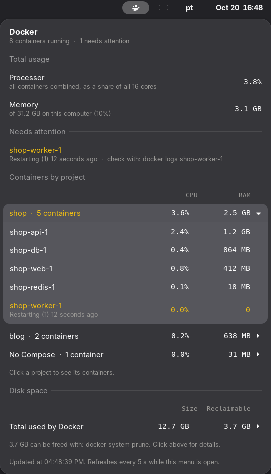

# Docker Monitor

A GNOME Shell extension that puts a small whale in the top bar. Click it to see what Docker is doing on your machine: running containers, CPU, memory, disk usage, and anything that needs attention.



## Features

- **Just an icon in the panel.** A monochrome symbolic icon that follows your theme, like the Wi-Fi and sound icons. Everything else lives in the menu.
- **Total usage.** CPU as a share of the whole processor (not of a single core, as `docker stats` shows it) and memory compared to what the computer has.
- **Needs attention.** Containers that are restarting, unhealthy or otherwise not running are listed at the top, with the command to check their logs.
- **Grouped by Compose project.** Containers are grouped by `com.docker.compose.project` and sorted by memory. Click a project to expand it.
- **Disk usage.** How much space images, containers, volumes and build cache take, and how much `docker system prune` would free.
- **Explained.** Every number has a short line saying what it means.
- **Idle when closed.** Docker is queried every 5 seconds only while the menu is open. Closed, the extension runs nothing.
- **Translated.** English, Brazilian Portuguese and Spanish, following the system language.

## Requirements

- GNOME Shell 48, 49 or 50
- The `docker` command available to your user (your user in the `docker` group, or rootless Docker)

## Install

```bash
git clone https://github.com/vasapolin/gnome-docker-monitor.git
cd gnome-docker-monitor
make install
```

Then log out and back in (on Wayland, GNOME only loads new extensions at login) and enable it:

```bash
gnome-extensions enable docker-monitor@vasapolin
```

`make install` needs `msgfmt` from the `gettext` package to compile the translations. If you do not have it, Python ships an equivalent:

```bash
make install MSGFMT="python3 /usr/share/doc/python3.*/examples/i18n/msgfmt.py"
```

## Development

| Command | What it does |
|---|---|
| `make` | Builds `build/docker-monitor@vasapolin.shell-extension.zip` |
| `make install` | Builds and installs for the current user |
| `make uninstall` | Removes it |
| `make pot` | Updates `po/docker-monitor.pot` and merges it into each translation (needs `xgettext` and `msgmerge`) |
| `make clean` | Deletes `build/` |

To try changes without logging out, run a nested GNOME Shell:

```bash
dbus-run-session -- gnome-shell --nested --wayland
```

### Adding a translation

1. Copy `po/docker-monitor.pot` to `po/<lang>.po` and translate it.
2. Add `<lang>` to `po/LINGUAS`.
3. Run `make install` and test with `LANGUAGE=<lang>` in a nested shell.

## How it works

While the menu is open, the extension runs three commands in parallel and renders the result:

```
docker stats --no-stream --format '{{json .}}'   # CPU and memory per container
docker ps --format '{{json .}}'                  # state, status and Compose labels
docker system df --format '{{json .}}'           # disk usage
```

Nothing is sent anywhere, and nothing is changed: the extension only reads.

## License

[MIT](LICENSE)

Docker and the Docker logo are trademarks of Docker, Inc. This project is not affiliated with Docker, Inc.; its icon is an original drawing.
